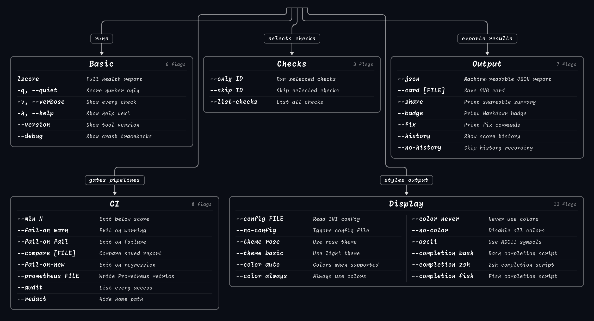

# lscore

lscore gives a linux machine a health score from 0 to 100.

it runs 33 checks that only read system state. it prints one score one letter grade and five category scores. it also lists the problems it found with fixes you can review.

it is one python file with no dependencies and works on python 3.8 or newer.

## usage



```sh
lscore                            # normal score report
lscore -v                         # show every check and its result
lscore -q                         # print only the number
lscore --history                  # show recorded runs over time
lscore --fix                      # print fixes to review. runs nothing
lscore --card out.svg             # write an svg score card
lscore --share                    # plain text summary for a post
lscore --badge                    # markdown badge for your readme
lscore --only storage             # run one category or check id
lscore --skip telemetry           # skip a category or check id
lscore --list-checks              # list all 33 checks
lscore --json                     # json output for scripts
lscore --min 80                   # exit 1 if the score is below 80
lscore --compare old.json         # compare with a saved report
lscore --fail-on-new              # with --compare exit 1 on new issues
lscore --prometheus metrics.prom  # write prometheus metrics
lscore --audit --redact           # show files read and commands run
lscore --no-history               # do not record this run
```

save a baseline before you use --compare:

```sh
lscore --json > old.json
```

## what it checks

speed covers boot time failed services available memory swap oom kills cpu load ssd trim and startup apps.

security covers the firewall clock sync pending updates reboot state ssh hardening open ports apparmor or selinux cpu mitigations disk encryption and ssh key permissions.

privacy covers telemetry and crash reporters encrypted dns network announcements and home folder permissions.

storage covers disk space raid health read only filesystems package cache system logs user cache trash and unused packages.

battery and heat covers battery health charge limits power management and cpu temperature.

checks run in parallel. anything that does not apply is skipped and left out of the score.

## installation

```sh
git clone https://github.com/PzN2s/lscore.git
cd lscore
./install.sh
lscore
```

install.sh uses ~/.local/bin for a normal user and /usr/local/bin for root. pass --user --system or --prefix dir to choose.

other options:

```sh
pipx install .
nix profile install .
```

the aur pkgbuild is in packaging/aur/.

## notes and limits

lscore only reads system state. it does not change settings and it does not start or stop services. most checks work as a normal user.

some checks need root or an extra tool to give a real answer. firewall rules and the process behind an open port are the common cases. without root those checks are skipped or less detailed. a skipped check is left out of the score and is not counted as a pass.

some checks only apply to laptops or to specific setups. for example disk encryption is only judged on laptops.

inside a container some checks are skipped because they would describe the host and not the container.

there are no network calls and no telemetry. history is stored at ~/.local/state/lscore/history.jsonl unless you pass --no-history. --audit lists every file read and every command run. --redact hides your home path in that output.

results depend on the distro and kernel so two machines can get different scores and both can be right. the number is a starting point for fixing things. it is not a benchmark.

## supported systems

tested on debian ubuntu fedora arch opensuse alpine and nixos. package checks use apt dnf pacman zypper apk xbps rpm-ostree or emerge when available. void and gentoo are partially supported. other linux systems with python 3.8 or newer should work but some checks may be skipped.

## license

mit. see [the license](LICENSE).
